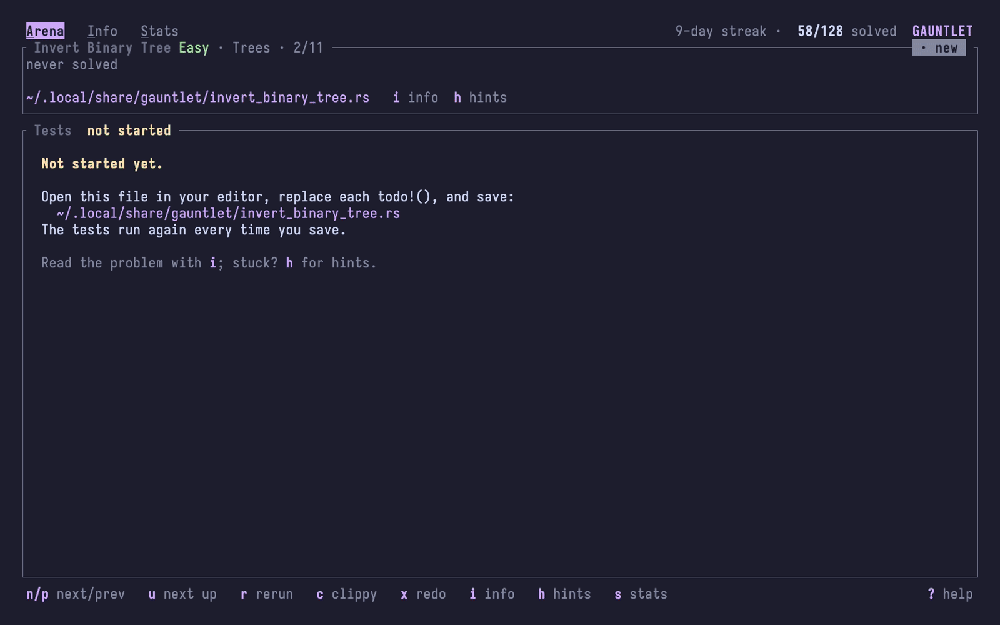
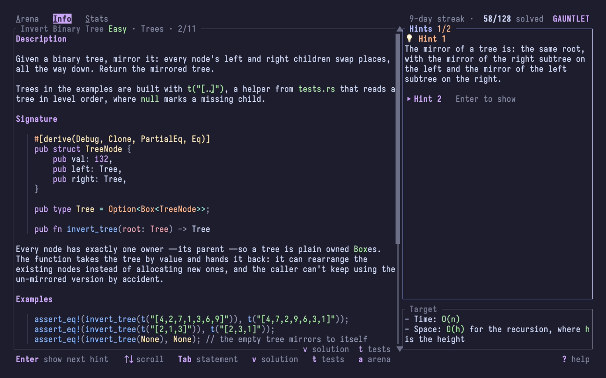
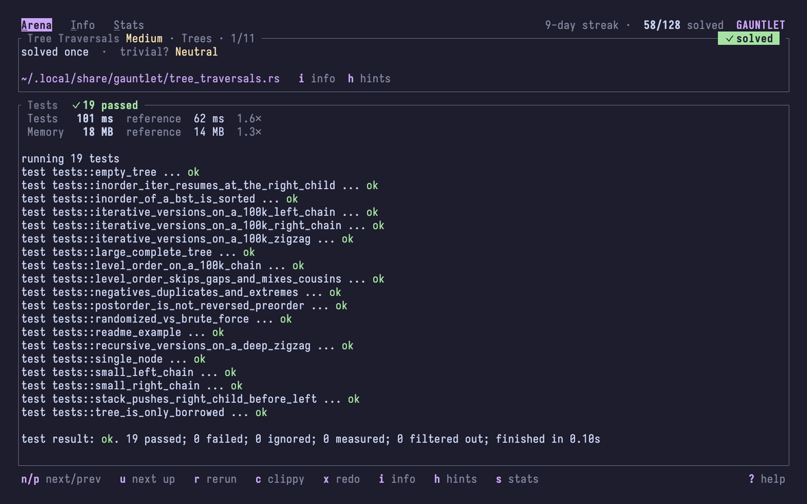
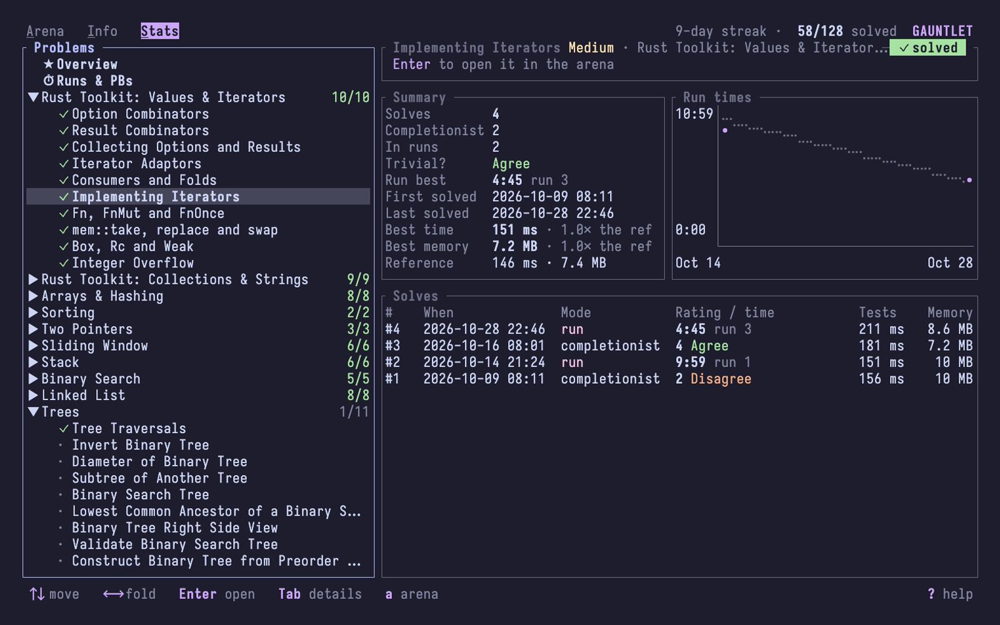
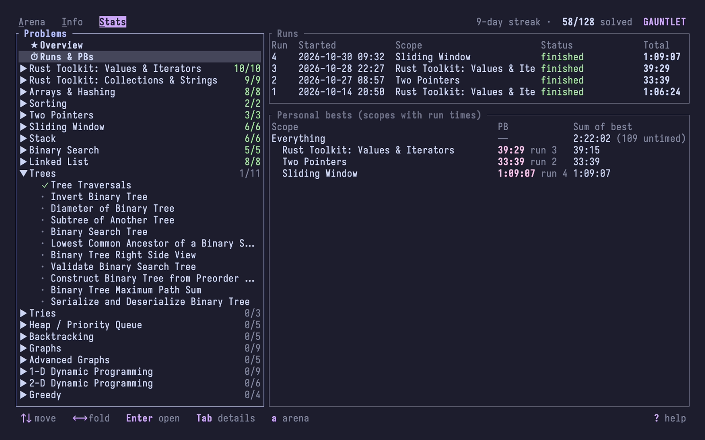
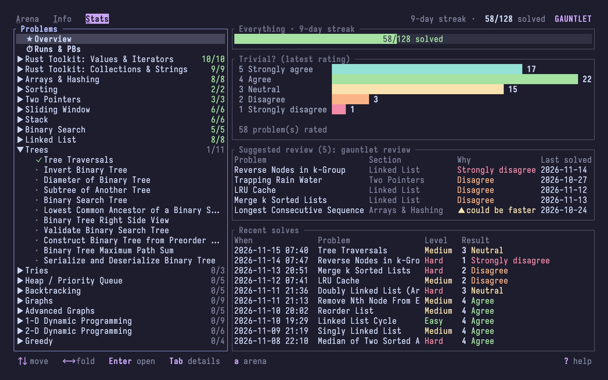

# Welcome to the Gauntlet

[](https://github.com/BenjaminLucier/gauntlet/actions/workflows/ci.yml)

128 practice problems that take you from knowing Rust to being fluent in it:
the standard library you reach for every day, then data structures and
algorithms, built and applied. Solve everything once. Then run the gauntlet
against the clock.

Read [the Book](https://doc.rust-lang.org/book/), work through
[Rust by Example](https://doc.rust-lang.org/rust-by-example/) and
[rustlings](https://github.com/rust-lang/rustlings). They teach the language;
the gauntlet is the grind that comes after. Run `gauntlet` and it opens your next
problem. Write code in your editor and save, and the tests run. When they
pass, the problem is solved and you say how trivial it felt. When you've
solved enough, `gauntlet run` puts you through a timed run and keeps your
personal bests.



## What's in it

- **128 problems in 22 sections**, one after the other:
  - **Rust Toolkit** (2 sections, 19 drills): the standard library that
    algorithm code leans on, from `Option` combinators and iterators to the
    `HashMap` entry API, `BTreeMap` ranges, `mem::take`, `Rc` and overflow.
    Each drill is many small functions, a line or two once you know the API.
  - **89 interview problems**, grouped by technique, from arrays and hashing
    to dynamic programming and bit manipulation. One problem per idea: where
    two classics teach the same thing, the harder one stays.
  - **20 data structures and algorithms built from scratch**, with the
    textbook API plus the traits a Rust user expects: a dynamic array, a hash
    map, a heap, a trie, union-find, Dijkstra, and more. Each sits just before
    the first problem that needs it; a segment tree and KMP close the gauntlet.
- **Idiomatic Rust.** Problems take borrowed slices and return `Option`s and
  `Result`s rather than `-1`s. Every statement has a *Rust notes* section
  with the APIs and traps that matter.
- **Exhaustive tests.** 12 to 30 per problem: worked examples, edge cases,
  tests named after the classic mistakes, randomized cross-checks against
  brute force, and inputs large enough that the slow approach fails.
- **Two ways to play.** Completionist to learn, runs to race. The problems
  you found hardest come back for review, and progress never expires.
- **Measured against the reference.** Every pass shows how long the tests
  took and their peak memory, next to the reference solution's on your
  machine. A solution well off its pace gets a gentle nudge.

## Requirements

- macOS, Linux or Windows.
- Rust 1.91 or later with clippy, from [rustup](https://rustup.rs):
  `rustup component add clippy`. Gauntlet compiles your code with the
  `rustc` and `clippy-driver` on your `PATH`; it doesn't need cargo.
- A linker, which rustup doesn't install: on macOS the Xcode Command Line
  Tools (`xcode-select --install`), on Linux a C toolchain such as
  `build-essential`, on Windows the
  [Visual Studio Build Tools](https://visualstudio.microsoft.com/visual-cpp-build-tools/)
  with the "Desktop development with C++" workload (rustup's installer
  offers to install them).

Gauntlet checks that rustc is there and new enough when it starts, that
clippy is when you ask for a review, and says what to install if a compile
fails for want of a linker.

## Install

**macOS and Linux**, with [Homebrew](https://brew.sh):

```sh
brew install BenjaminLucier/tap/gauntlet
```

**Windows**, in PowerShell:

```powershell
irm https://github.com/BenjaminLucier/gauntlet/releases/latest/download/install.ps1 | iex
```

This installs to `%LOCALAPPDATA%\Programs\gauntlet` and adds that folder to
your PATH. Set `GAUNTLET_VERSION` first for a particular version.

**With Rust**, anywhere:

```sh
cargo install --locked gauntlet            # from crates.io
cargo binstall gauntlet                    # a prebuilt binary, with cargo-binstall
```

Every [release](https://github.com/BenjaminLucier/gauntlet/releases) also
has archives for macOS, Linux and Windows on x86_64 and ARM64, with SHA-256
checksums and [build attestations](https://docs.github.com/en/actions/security-for-github-actions/using-artifact-attestations)
(`gh attestation verify <file> --repo BenjaminLucier/gauntlet`). From a
checkout of this repository: `cargo install --locked --path .`.

The 128 problems are built into the binary; nothing else is downloaded.

## The first five minutes

Run `gauntlet`. It opens on the **Arena** with
your next unsolved problem, which is *Option Combinators* the first time.
The header shows its working file,
`~/.local/share/gauntlet/option_combinators.rs` (on Windows,
`%APPDATA%\gauntlet\option_combinators.rs`), and the pane below says
*Not started*: every body is still `todo!()`. Press `i` for the statement,
`t` for the tests, `h` for hints.

<picture>
  <source media="(prefers-color-scheme: light)" srcset="https://raw.githubusercontent.com/BenjaminLucier/gauntlet/main/docs/images/latte/info.png">
  
</picture>

Open the data directory, `~/.local/share/gauntlet` (`%APPDATA%\gauntlet`),
in your editor, then that file. It holds only your code; the tests are attached when gauntlet compiles
it. Gauntlet keeps a `rust-project.json` there, so rust-analyzer works in
every working file.

Replace a `todo!()` and save: the tests run, and the Arena shows the compiler
errors or the failures. Tests still hitting `todo!()` are counted on one line
above the real failures. When every test passes, the problem is solved and
you rate it, and the Arena shows how long the tests took and their peak
memory (see [Runtime and memory](#runtime-and-memory)). `u` goes to the next unsolved problem, `n` and `p` move through
the list, and `?` shows every key.

<picture>
  <source media="(prefers-color-scheme: light)" srcset="https://raw.githubusercontent.com/BenjaminLucier/gauntlet/main/docs/images/latte/arena.png">
  
</picture>

## Completionist mode

`gauntlet` works through every problem at your own pace; `gauntlet trees` or
`gauntlet three_sum` narrows it to a section or a problem. Every problem has 2–3 hints, revealed one at a time, and the
reference solution is one key away. Only the problem on screen is tested;
another problem's file is tested when you open it. A pass needs at least one
test to run and none to fail.

After each solve you answer one question, keys `1`–`5`:

> **I found this problem to be trivial.**
> 1 Strongly disagree · 2 Disagree · 3 Neutral · 4 Agree · 5 Strongly agree

It's required: an unanswered solve is asked again on the next start. Press
`x` to redo a problem from a fresh template (your old file is overwritten);
passing it again is a new solve. Every solve is kept in the problem's
history, so you can watch a 1 turn into a 5.

<picture>
  <source media="(prefers-color-scheme: light)" srcset="https://raw.githubusercontent.com/BenjaminLucier/gauntlet/main/docs/images/latte/problem.png">
  
</picture>

## Review

`gauntlet review [scope]` is completionist mode over the problems up for
review: those whose latest rating is 1 or 2, hardest first, then those whose
best solution is well off the reference's runtime or memory (marked `▲`),
then least recently solved. Redo one with `x`, pass it, and rate it again; a
3 or more takes it off the list, and so does a solution back on the
reference's pace. `u` goes to the next one. With nothing to review it says
so and exits.

## Runtime and memory

A solution is right when its tests pass: speed never decides that. The tests
run one at a time, and are stopped after 30 seconds only in case your code
hangs. What a pass does show, above the test output, is how long they took
and their peak memory, next to the reference solution's:

```text
 Tests   842 ms  reference  80 ms   10×  ▲ this could probably be faster
 Memory   41 MB  reference  12 MB  3.4×
```

The reference is measured the same way on your machine, in the background
after your first pass of a problem (the comparison appears when it's done),
and kept in the cache. Raw timings don't travel between machines; the ratio
to the reference on the same machine mostly does. Each solve records its
numbers in the log, and a problem's Stats page shows your best runtime and
best memory, each the best of any passing run of the tests, completionist or
run, against the reference. Improving a solved problem's code and saving
updates them without counting as another solve.

When your best takes more than 2× the reference's time and over 0.3 s
longer, or more than 2× its memory and over 32 MB more, the problem is marked
`▲` in Stats and suggested for review: it could probably be faster, or
leaner. A faster or leaner pass clears it. Below either bar the difference is mostly
process startup and noise.

## Runs

`gauntlet run [scope]` starts a timed run over a scope (the whole gauntlet by
default), from fresh templates in `runs/<n>/` in your data directory:

- **The clock charges the problem on screen.** `p` pauses; quitting pauses
  too. `gauntlet run` again resumes.
- **Skip, don't escape.** `n` sends the problem to the back of the queue, and
  its time comes with it. The run ends only when everything is solved.
- **No hints, no solution, no rating.** The tests are still there (`t`).
- **One run at a time.** `gauntlet run --delete` abandons it and deletes its
  files; it won't count for PBs, but its solves still count as solved.

The clock is an honour system. A run is a personal challenge to see whether
you improve over time, not a tamper-proof timer: nothing stops you pausing,
quitting or reading ahead, and that's fine.

A personal best is the best time ever recorded for a problem, a section or
the whole gauntlet, whichever run it came from: one full run gives you a PB
for every section, and a run over just `graphs` is just as good a `graphs`
PB. Your *sum of best* is each problem's fastest time, added up. Finishing a
section in a run shows your split against its PB.

<picture>
  <source media="(prefers-color-scheme: light)" srcset="https://raw.githubusercontent.com/BenjaminLucier/gauntlet/main/docs/images/latte/runs.png">
  
</picture>

Solves in a run count towards completion too. The code you wrote in a run is
kept until you `gauntlet run --clean` it; its times and PBs stay.

## Stats

`s` in the app, or `gauntlet stats [scope]`. The **Overview** has your
progress and streak, your ratings, a *Suggested review* panel (what
`gauntlet review` would bring back) and recent solves. **Runs** lists every
run, with the PB and sum of best of the whole gauntlet and each section.
Each section has a page of its problems, which `o` orders least trivial
first, and each problem a page of its solves and run times, with your best
runtime and memory against the reference solution's. `▲` marks a problem
off the reference's pace. `Enter` opens the selected problem in the Arena.

<picture>
  <source media="(prefers-color-scheme: light)" srcset="https://raw.githubusercontent.com/BenjaminLucier/gauntlet/main/docs/images/latte/stats.png">
  
</picture>

## Commands

A scope is `all`, a section (`trees`) or a problem (`three_sum`). An exact
name wins, then a unique part of one (`pointers`); anything ambiguous or
unknown is an error that lists the candidates.

```sh
gauntlet [scope]            # completionist mode, narrowed to scope
gauntlet review [scope]     # completionist mode over the problems you rated 1 or 2, or off the pace
gauntlet run [scope]        # start a timed run over scope (default: all), or resume yours
gauntlet run --delete       # abandon the run in progress and delete its files
gauntlet run --clean [n]    # delete the saved code of finished run n, or of every finished run
gauntlet stats [scope]      # straight to the stats
gauntlet reset              # delete your working files, runs and every event
gauntlet --version · --help # -V, -h; --help also says where your data is
```

`--yes` (`-y`) skips confirmations. `check` and `readme` are maintainer
commands, covered in [CONTRIBUTING.md](CONTRIBUTING.md).

## Keys

The ones to start with; `?` in the app lists them all.

| Key                | Does                                                    |
|--------------------|---------------------------------------------------------|
| `a` `i` `s`        | Arena, Info, Stats                                      |
| `n` `p` or `→` `←` | next or previous problem (in a run: `n` skips, `p` pauses) |
| `u`                | next up: the first unsolved problem, or the next to review |
| `r` `c`            | run the tests again, run clippy                         |
| `h` `v` `t`        | hints, the reference solution, the tests                |
| `←` `→` or `h` `l` | in Stats: fold and unfold the tree; on a problem, `←` goes up to its section |
| `x`                | redo from a fresh template                              |
| `Tab`              | move between panes                                      |
| `q`                | quit; `Esc` goes back to the Arena first                |

## Your data

```text
~/.local/share/gauntlet/        $XDG_DATA_HOME/gauntlet
  three_sum.rs                  your working file: only your code
  runs/4/three_sum.rs           your code in run 4
  run.json                      the run in progress, if any
  events.jsonl                  every solve (with its runtime and memory), rating and run, one JSON object per line
  rust-project.json             the working files, for rust-analyzer
~/.cache/gauntlet/              $XDG_CACHE_HOME/gauntlet: safe to delete
  content/<version>-<hash>/     the problems, extracted from the binary
  build/                        your code compiled with its tests
  reference.json                the reference solutions' runtime and memory on this machine
~/.local/state/gauntlet/gauntlet.log
```

These are the XDG locations (`$XDG_STATE_HOME` for the log), on macOS too.
On Windows:

```text
%APPDATA%\gauntlet\             your data (C:\Users\<you>\AppData\Roaming\gauntlet)
%LOCALAPPDATA%\gauntlet\        content\, build\ and reference.json: safe to delete (C:\Users\<you>\AppData\Local\gauntlet)
%LOCALAPPDATA%\gauntlet\gauntlet.log
```

There, the XDG variables count only if you set them.
Only one gauntlet at a time can have a data directory open.

| Variable               | Effect                                                         |
|------------------------|----------------------------------------------------------------|
| `GAUNTLET_CONTENT_DIR` | Read the problems from this directory instead of the built-in copy, such as a checkout's `content/`. |
| `GAUNTLET_LOG`         | `debug` or `trace` to log more.                                |
| `GAUNTLET_THEME`       | `light` or `dark`: [Catppuccin](https://catppuccin.com) Latte or Mocha, if the guess from your terminal is wrong. |
| `NO_COLOR`             | Set and not empty: no colour, as [no-color.org](https://no-color.org) asks. Selections show in reverse video, secondary text dimmed. |

Every status and statistic is derived from `events.jsonl`, an append-only
log that is easy to analyse with `jq`.

`gauntlet reset` deletes gauntlet's own files in the data directory (working
files, runs, run state, events and `rust-project.json`) and the compiled
tests. Anything else you keep there is left alone. It asks you to type
`reset` first.

To uninstall, remove the binary the way you installed it
(`brew uninstall gauntlet` or `cargo uninstall gauntlet`; on Windows, delete
`%LOCALAPPDATA%\Programs\gauntlet` and remove it from your PATH), then
delete `~/.local/share/gauntlet`, `~/.cache/gauntlet` and
`~/.local/state/gauntlet` (on Windows, `%APPDATA%\gauntlet` and
`%LOCALAPPDATA%\gauntlet`).

## Contributing

See [CONTRIBUTING.md](CONTRIBUTING.md).

## License

Licensed under either of [Apache License, Version 2.0](LICENSE-APACHE) or
[MIT license](LICENSE-MIT) at your option.

Unless you explicitly state otherwise, any contribution intentionally submitted
for inclusion in this project by you, as defined in the Apache-2.0 license,
shall be dual licensed as above, without any additional terms or conditions.

## Problems

<!-- problems:start -->

### Rust Toolkit: Values & Iterators

| Problem | Difficulty |
|---|---|
| [Option Combinators](content/01_toolkit_values/01_option_combinators/README.md) | Easy |
| [Result Combinators](content/01_toolkit_values/02_result_combinators/README.md) | Easy |
| [Collecting Options and Results](content/01_toolkit_values/03_collecting_options_results/README.md) | Easy |
| [Iterator Adaptors](content/01_toolkit_values/04_adaptors/README.md) | Easy |
| [Consumers and Folds](content/01_toolkit_values/05_consumers_and_folds/README.md) | Easy |
| [Implementing Iterators](content/01_toolkit_values/06_implementing_iterators/README.md) | Medium |
| [Fn, FnMut and FnOnce](content/01_toolkit_values/07_fn_traits/README.md) | Easy |
| [mem::take, replace and swap](content/01_toolkit_values/08_mem_take_replace_swap/README.md) | Easy |
| [Box, Rc and Weak](content/01_toolkit_values/09_box_rc_weak/README.md) | Medium |
| [Integer Overflow](content/01_toolkit_values/10_integer_overflow/README.md) | Medium |

### Rust Toolkit: Collections & Strings

| Problem | Difficulty |
|---|---|
| [Searching and Splitting](content/02_toolkit_collections/01_searching_and_splitting/README.md) | Easy |
| [Editing in Place](content/02_toolkit_collections/02_editing_in_place/README.md) | Easy |
| [str Methods](content/02_toolkit_collections/03_str_methods/README.md) | Easy |
| [Chars and UTF-8](content/02_toolkit_collections/04_chars_and_utf8/README.md) | Medium |
| [Building Strings and Cow](content/02_toolkit_collections/05_building_strings_and_cow/README.md) | Medium |
| [HashMap and Entry](content/02_toolkit_collections/06_hashmap_and_entry/README.md) | Easy |
| [BTreeMap and Ranges](content/02_toolkit_collections/07_btreemap_and_ranges/README.md) | Easy |
| [VecDeque and BinaryHeap](content/02_toolkit_collections/08_vecdeque_and_binaryheap/README.md) | Easy |
| [Ordering and Hashing](content/02_toolkit_collections/09_ordering_and_hashing/README.md) | Medium |

### Arrays & Hashing

| Problem | Difficulty |
|---|---|
| [Dynamic Array](content/03_arrays_hashing/01_dynamic_array/README.md) | Medium |
| [Hash Map (Separate Chaining)](content/03_arrays_hashing/02_hash_map_chaining/README.md) | Medium |
| [Two Sum](content/03_arrays_hashing/03_two_sum/README.md) | Easy |
| [Group Anagrams](content/03_arrays_hashing/04_group_anagrams/README.md) | Medium |
| [Top K Frequent Elements](content/03_arrays_hashing/05_top_k_frequent_elements/README.md) | Medium |
| [Encode and Decode Strings](content/03_arrays_hashing/06_encode_and_decode_strings/README.md) | Medium |
| [Product of Array Except Self](content/03_arrays_hashing/07_product_of_array_except_self/README.md) | Medium |
| [Longest Consecutive Sequence](content/03_arrays_hashing/08_longest_consecutive_sequence/README.md) | Medium |

### Sorting

| Problem | Difficulty |
|---|---|
| [Merge Sort](content/04_sorting/01_merge_sort/README.md) | Medium |
| [Quicksort](content/04_sorting/02_quicksort/README.md) | Medium |

### Two Pointers

| Problem | Difficulty |
|---|---|
| [3Sum](content/05_two_pointers/01_three_sum/README.md) | Medium |
| [Container With Most Water](content/05_two_pointers/02_container_with_most_water/README.md) | Medium |
| [Trapping Rain Water](content/05_two_pointers/03_trapping_rain_water/README.md) | Hard |

### Sliding Window

| Problem | Difficulty |
|---|---|
| [Best Time to Buy and Sell Stock](content/06_sliding_window/01_best_time_to_buy_and_sell_stock/README.md) | Easy |
| [Longest Substring Without Repeating Characters](content/06_sliding_window/02_longest_substring_without_repeating_characters/README.md) | Medium |
| [Longest Repeating Character Replacement](content/06_sliding_window/03_longest_repeating_character_replacement/README.md) | Medium |
| [Minimum Window Substring](content/06_sliding_window/04_minimum_window_substring/README.md) | Hard |
| [Ring Buffer Deque](content/06_sliding_window/05_ring_deque/README.md) | Medium |
| [Sliding Window Maximum](content/06_sliding_window/06_sliding_window_maximum/README.md) | Hard |

### Stack

| Problem | Difficulty |
|---|---|
| [Stack](content/07_stack/01_stack_from_scratch/README.md) | Easy |
| [Valid Parentheses](content/07_stack/02_valid_parentheses/README.md) | Easy |
| [Min Stack](content/07_stack/03_min_stack/README.md) | Medium |
| [Evaluate Reverse Polish Notation](content/07_stack/04_evaluate_reverse_polish_notation/README.md) | Medium |
| [Daily Temperatures](content/07_stack/05_daily_temperatures/README.md) | Medium |
| [Largest Rectangle in Histogram](content/07_stack/06_largest_rectangle_in_histogram/README.md) | Hard |

### Binary Search

| Problem | Difficulty |
|---|---|
| [Binary Search & Bounds](content/08_binary_search/01_binary_search_bounds/README.md) | Easy |
| [Koko Eating Bananas](content/08_binary_search/02_koko_eating_bananas/README.md) | Medium |
| [Search in Rotated Sorted Array](content/08_binary_search/03_search_in_rotated_sorted_array/README.md) | Medium |
| [Time Based Key-Value Store](content/08_binary_search/04_time_based_key_value_store/README.md) | Medium |
| [Median of Two Sorted Arrays](content/08_binary_search/05_median_of_two_sorted_arrays/README.md) | Hard |

### Linked List

| Problem | Difficulty |
|---|---|
| [Singly Linked List](content/09_linked_list/01_singly_linked_list/README.md) | Medium |
| [Linked List Cycle](content/09_linked_list/02_linked_list_cycle/README.md) | Easy |
| [Reorder List](content/09_linked_list/03_reorder_list/README.md) | Medium |
| [Remove Nth Node From End of List](content/09_linked_list/04_remove_nth_node_from_end_of_list/README.md) | Medium |
| [Doubly Linked List (Arena)](content/09_linked_list/05_doubly_linked_list/README.md) | Hard |
| [LRU Cache](content/09_linked_list/06_lru_cache/README.md) | Medium |
| [Merge k Sorted Lists](content/09_linked_list/07_merge_k_sorted_lists/README.md) | Hard |
| [Reverse Nodes in k-Group](content/09_linked_list/08_reverse_nodes_in_k_group/README.md) | Hard |

### Trees

| Problem | Difficulty |
|---|---|
| [Tree Traversals](content/10_trees/01_tree_traversals/README.md) | Medium |
| [Invert Binary Tree](content/10_trees/02_invert_binary_tree/README.md) | Easy |
| [Diameter of Binary Tree](content/10_trees/03_diameter_of_binary_tree/README.md) | Easy |
| [Subtree of Another Tree](content/10_trees/04_subtree_of_another_tree/README.md) | Easy |
| [Binary Search Tree](content/10_trees/05_binary_search_tree/README.md) | Hard |
| [Lowest Common Ancestor of a Binary Search Tree](content/10_trees/06_lowest_common_ancestor_of_a_bst/README.md) | Medium |
| [Binary Tree Right Side View](content/10_trees/07_binary_tree_right_side_view/README.md) | Medium |
| [Validate Binary Search Tree](content/10_trees/08_validate_binary_search_tree/README.md) | Medium |
| [Construct Binary Tree from Preorder and Inorder Traversal](content/10_trees/09_construct_binary_tree_from_preorder_and_inorder/README.md) | Medium |
| [Binary Tree Maximum Path Sum](content/10_trees/10_binary_tree_maximum_path_sum/README.md) | Hard |
| [Serialize and Deserialize Binary Tree](content/10_trees/11_serialize_and_deserialize_binary_tree/README.md) | Hard |

### Tries

| Problem | Difficulty |
|---|---|
| [Trie](content/11_tries/01_trie/README.md) | Medium |
| [Design Add and Search Words Data Structure](content/11_tries/02_design_add_and_search_words/README.md) | Medium |
| [Word Search II](content/11_tries/03_word_search_ii/README.md) | Hard |

### Heap / Priority Queue

| Problem | Difficulty |
|---|---|
| [Binary Heap](content/12_heap_priority_queue/01_binary_heap/README.md) | Medium |
| [K Closest Points to Origin](content/12_heap_priority_queue/02_k_closest_points_to_origin/README.md) | Medium |
| [Kth Largest Element in an Array](content/12_heap_priority_queue/03_kth_largest_element_in_an_array/README.md) | Medium |
| [Task Scheduler](content/12_heap_priority_queue/04_task_scheduler/README.md) | Medium |
| [Find Median from Data Stream](content/12_heap_priority_queue/05_find_median_from_data_stream/README.md) | Hard |

### Backtracking

| Problem | Difficulty |
|---|---|
| [Combination Sum II](content/13_backtracking/01_combination_sum_ii/README.md) | Medium |
| [Permutations](content/13_backtracking/02_permutations/README.md) | Medium |
| [Subsets II](content/13_backtracking/03_subsets_ii/README.md) | Medium |
| [Palindrome Partitioning](content/13_backtracking/04_palindrome_partitioning/README.md) | Medium |
| [N-Queens](content/13_backtracking/05_n_queens/README.md) | Hard |

### Graphs

| Problem | Difficulty |
|---|---|
| [BFS and DFS](content/14_graphs/01_bfs_dfs/README.md) | Medium |
| [Max Area of Island](content/14_graphs/02_max_area_of_island/README.md) | Medium |
| [Clone Graph](content/14_graphs/03_clone_graph/README.md) | Medium |
| [Rotting Oranges](content/14_graphs/04_rotting_oranges/README.md) | Medium |
| [Pacific Atlantic Water Flow](content/14_graphs/05_pacific_atlantic_water_flow/README.md) | Medium |
| [Topological Sort](content/14_graphs/06_topological_sort/README.md) | Medium |
| [Union-Find](content/14_graphs/07_union_find/README.md) | Medium |
| [Redundant Connection](content/14_graphs/08_redundant_connection/README.md) | Medium |
| [Word Ladder](content/14_graphs/09_word_ladder/README.md) | Hard |

### Advanced Graphs

| Problem | Difficulty |
|---|---|
| [Dijkstra's Algorithm](content/15_advanced_graphs/01_dijkstra/README.md) | Medium |
| [Minimum Spanning Tree](content/15_advanced_graphs/02_minimum_spanning_tree/README.md) | Medium |
| [Swim in Rising Water](content/15_advanced_graphs/03_swim_in_rising_water/README.md) | Hard |
| [Alien Dictionary](content/15_advanced_graphs/04_alien_dictionary/README.md) | Hard |
| [Cheapest Flights Within K Stops](content/15_advanced_graphs/05_cheapest_flights_within_k_stops/README.md) | Medium |

### 1-D Dynamic Programming

| Problem | Difficulty |
|---|---|
| [Climbing Stairs](content/16_dp_1d/01_climbing_stairs/README.md) | Easy |
| [House Robber II](content/16_dp_1d/02_house_robber_ii/README.md) | Medium |
| [Longest Palindromic Substring](content/16_dp_1d/03_longest_palindromic_substring/README.md) | Medium |
| [Decode Ways](content/16_dp_1d/04_decode_ways/README.md) | Medium |
| [Coin Change](content/16_dp_1d/05_coin_change/README.md) | Medium |
| [Maximum Product Subarray](content/16_dp_1d/06_maximum_product_subarray/README.md) | Medium |
| [Word Break](content/16_dp_1d/07_word_break/README.md) | Medium |
| [Longest Increasing Subsequence](content/16_dp_1d/08_longest_increasing_subsequence/README.md) | Medium |
| [Partition Equal Subset Sum](content/16_dp_1d/09_partition_equal_subset_sum/README.md) | Medium |

### 2-D Dynamic Programming

| Problem | Difficulty |
|---|---|
| [Unique Paths](content/17_dp_2d/01_unique_paths/README.md) | Medium |
| [Longest Common Subsequence](content/17_dp_2d/02_longest_common_subsequence/README.md) | Medium |
| [Best Time to Buy and Sell Stock with Cooldown](content/17_dp_2d/03_best_time_to_buy_and_sell_stock_with_cooldown/README.md) | Medium |
| [Longest Increasing Path in a Matrix](content/17_dp_2d/04_longest_increasing_path_in_a_matrix/README.md) | Hard |
| [Edit Distance](content/17_dp_2d/05_edit_distance/README.md) | Medium |
| [Regular Expression Matching](content/17_dp_2d/06_regular_expression_matching/README.md) | Hard |

### Greedy

| Problem | Difficulty |
|---|---|
| [Maximum Subarray](content/18_greedy/01_maximum_subarray/README.md) | Medium |
| [Jump Game II](content/18_greedy/02_jump_game_ii/README.md) | Medium |
| [Gas Station](content/18_greedy/03_gas_station/README.md) | Medium |
| [Partition Labels](content/18_greedy/04_partition_labels/README.md) | Medium |

### Intervals

| Problem | Difficulty |
|---|---|
| [Merge Intervals](content/19_intervals/01_merge_intervals/README.md) | Medium |
| [Non-overlapping Intervals](content/19_intervals/02_non_overlapping_intervals/README.md) | Medium |
| [Meeting Rooms II](content/19_intervals/03_meeting_rooms_ii/README.md) | Medium |
| [Minimum Interval to Include Each Query](content/19_intervals/04_minimum_interval_to_include_each_query/README.md) | Hard |

### Math & Geometry

| Problem | Difficulty |
|---|---|
| [Rotate Image](content/20_math_geometry/01_rotate_image/README.md) | Medium |
| [Spiral Matrix](content/20_math_geometry/02_spiral_matrix/README.md) | Medium |
| [Pow(x, n)](content/20_math_geometry/03_pow_x_n/README.md) | Medium |
| [Multiply Strings](content/20_math_geometry/04_multiply_strings/README.md) | Medium |

### Bit Manipulation

| Problem | Difficulty |
|---|---|
| [Single Number](content/21_bit_manipulation/01_single_number/README.md) | Easy |
| [Counting Bits](content/21_bit_manipulation/02_counting_bits/README.md) | Easy |
| [Sum of Two Integers](content/21_bit_manipulation/03_sum_of_two_integers/README.md) | Medium |
| [Reverse Integer](content/21_bit_manipulation/04_reverse_integer/README.md) | Medium |

### Advanced Structures & String Matching

| Problem | Difficulty |
|---|---|
| [Segment Tree](content/22_advanced_structures/01_segment_tree/README.md) | Medium |
| [Knuth–Morris–Pratt](content/22_advanced_structures/02_kmp/README.md) | Medium |

<!-- problems:end -->
